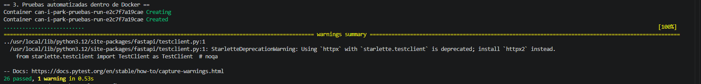
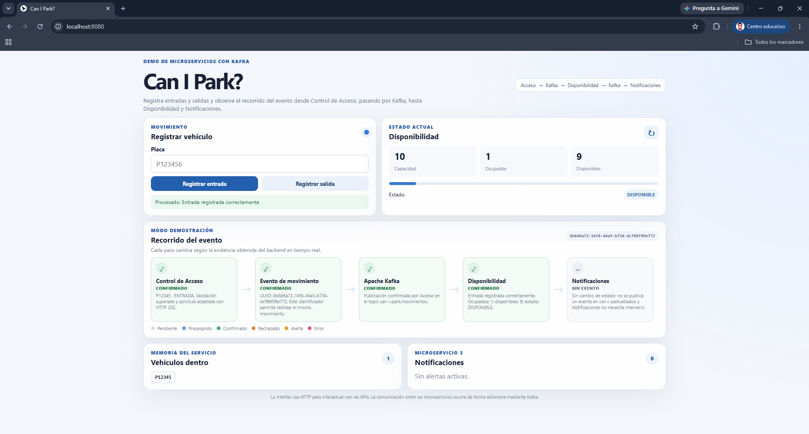
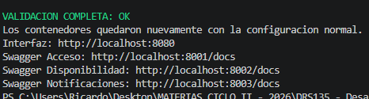
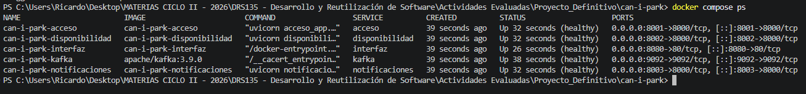

# Resultado de pruebas

Este documento resume las verificaciones realizadas durante la integración final de **Can I Park?**.

La validación se ejecutó utilizando Docker para mantener un entorno reproducible y evitar depender de la versión local de Python, `pip` o `pytest` instalada en la computadora del integrante.

---

## 1. Validación de la configuración Docker

Antes de ejecutar el sistema completo se verificó la configuración de Docker Compose mediante:

```bash
docker compose config
```

La configuración fue procesada correctamente y permitió verificar la definición de los siguientes servicios:

- Kafka.
- Control de Acceso.
- Disponibilidad.
- Notificaciones.
- Interfaz.
- Contenedor auxiliar de pruebas.

Los puertos expuestos para la demostración son:

- Interfaz: `http://localhost:8080`
- Control de Acceso: `http://localhost:8001`
- Disponibilidad: `http://localhost:8002`
- Notificaciones: `http://localhost:8003`
- Kafka: `localhost:9092`

---

## 2. Pruebas automatizadas

La validación completa ejecuta las pruebas automatizadas dentro de un contenedor con Python 3.12.

El resultado obtenido fue:

```text
26 passed, 1 warning
```

Las **26 pruebas finalizaron correctamente**.

El único aviso corresponde a una advertencia de deprecación relacionada con Starlette y `httpx`. Este warning no provocó errores ni afectó el resultado de las pruebas.

### Evidencia



---

## 3. Prueba E2E Acceso → Kafka → Disponibilidad

Se ejecutó una prueba de extremo a extremo que valida el flujo real:

```text
Control de Acceso
        ↓
      Kafka
        ↓
Disponibilidad
```

La prueba:

1. Espera que Control de Acceso y Disponibilidad estén disponibles.
2. Consulta el estado inicial del estacionamiento.
3. Genera una placa de prueba única.
4. Registra una `ENTRADA`.
5. Obtiene el `evento_id`.
6. Espera que Disponibilidad procese el evento recibido mediante Kafka.
7. Verifica que aumente la cantidad de espacios ocupados.
8. Registra una `SALIDA`.
9. Comprueba que el estado del estacionamiento regrese a sus valores iniciales.

Resultado:

```text
OK: el evento atravesó Kafka y la disponibilidad volvió al estado inicial.
```

La ejecución genera como evidencia técnica:

```text
docs/EVIDENCIA_E2E.txt
```

Este archivo es generado automáticamente durante la ejecución y está excluido del control de versiones mediante `.gitignore`.

---

## 4. Prueba E2E Disponibilidad → Kafka → Notificaciones

También se validó el segundo flujo asíncrono del sistema:

```text
Disponibilidad
      ↓
    Kafka
      ↓
Notificaciones
```

Durante esta prueba se utiliza temporalmente una capacidad reducida para provocar un cambio de estado y comprobar que Notificaciones reciba el evento publicado en:

```text
can-i-park.estados
```

Resultado:

```text
OK: el cambio de estado viajó por Kafka y Notificaciones generó la alerta.
```

La ejecución genera:

```text
docs/EVIDENCIA_NOTIFICACIONES_E2E.txt
```

Este archivo también es un artefacto temporal de ejecución y no forma parte del código fuente versionado.

---

## 5. Validación de la interfaz

El script de validación comprueba que la interfaz servida mediante Nginx pueda responder correctamente por HTTP.

Resultado:

```text
OK: la interfaz respondio correctamente.
```

La interfaz se encuentra disponible en:

```text
http://localhost:8080
```

Además, Nginx funciona como proxy inverso para comunicar la interfaz con los microservicios sin conectarse directamente con Apache Kafka.

### Evidencia visual



---

## 6. Validación completa del sistema

La validación principal se ejecutó en Windows mediante:

```powershell
Set-ExecutionPolicy -Scope Process -ExecutionPolicy Bypass
.\scripts\validar_entrega.ps1
```

El script realiza automáticamente:

1. Verificación de Docker.
2. Construcción del entorno reproducible de pruebas.
3. Validación de sintaxis dentro de Docker.
4. Ejecución de las pruebas automatizadas.
5. Preparación del entorno con Kafka real.
6. Prueba E2E Acceso → Kafka → Disponibilidad.
7. Prueba E2E Disponibilidad → Kafka → Notificaciones.
8. Validación HTTP de la interfaz.
9. Verificación del estado de los contenedores.
10. Restauración de la configuración normal del estacionamiento.

El resultado final obtenido fue:

```text
VALIDACION COMPLETA: OK
```

Después de finalizar las pruebas, el sistema restauró la configuración normal:

```text
CAPACIDAD_ESTACIONAMIENTO=100
UMBRAL_POCOS_ESPACIOS=10
```

### Evidencia



---

## 7. Estado final de los contenedores

Después de completar la validación se ejecutó:

```bash
docker compose ps
```

El resultado confirmó que todos los componentes principales quedaron funcionando correctamente:

| Componente | Estado |
|---|---|
| Kafka | `healthy` |
| Control de Acceso | `healthy` |
| Disponibilidad | `healthy` |
| Notificaciones | `healthy` |
| Interfaz | `healthy` |

Los servicios quedaron disponibles en sus puertos correspondientes después de restaurar la configuración normal.

### Evidencia



---

## 8. Portabilidad de la validación

La validación final está diseñada para no depender de Python, `pip` o `pytest` instalados directamente en la computadora del integrante.

El servicio auxiliar:

```text
pruebas
```

utiliza **Python 3.12 dentro de Docker** y contiene las dependencias necesarias para ejecutar las pruebas del proyecto.

Los scripts:

```text
scripts/validar_entrega.ps1
scripts/validar_entrega.sh
```

permiten ejecutar el proceso de validación en Windows y sistemas compatibles con Bash.

El script de PowerShell también verifica el código de salida de los comandos Docker. Si uno de ellos falla, la validación se detiene para evitar reportar incorrectamente un resultado exitoso.

---

## 9. Resultado final

La integración completa de **Can I Park?** fue validada satisfactoriamente.

Resultados obtenidos:

- **26 pruebas automatizadas aprobadas.**
- **E2E Acceso → Kafka → Disponibilidad aprobado.**
- **E2E Disponibilidad → Kafka → Notificaciones aprobado.**
- **Interfaz HTTP operativa.**
- **Kafka saludable.**
- **Control de Acceso saludable.**
- **Disponibilidad saludable.**
- **Notificaciones saludable.**
- **Interfaz saludable.**
- **Configuración normal 100 / 10 restaurada correctamente.**
- **VALIDACION COMPLETA: OK.**
